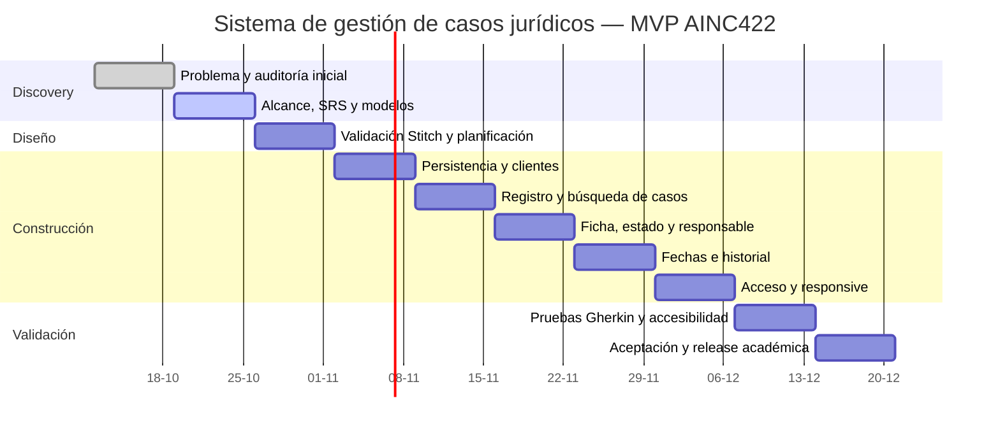

# Gantt actualizado del MVP

## Capacidad y supuestos

- Proyecto individual: una persona responsable de análisis, diseño, desarrollo y pruebas.
- Capacidad base: 12 horas semanales durante 10 semanas, total estimado de 120 horas.
- Las horas son planificación prospectiva y se actualizarán con registros reales.
- No se presupone disponibilidad productiva ni trabajo con datos reales.
- Una desviación superior a 20 % de la capacidad semanal obliga a replanificar,
  sin incorporar funciones diferidas.

## Cronograma

| Semana | Fechas | Trabajo estimado | Horas | Dependencia | Hito | Estado al 2026-10-22 |
|---|---|---|---:|---|---|---|
| W1 | 12–18 oct. | Revisar problema, evidencia y código v0.2.0 | 12 | Ninguna | Inicio discovery | Antecedentes disponibles |
| W2 | 19–25 oct. | Rebaselinar objetivos, SRS, historias, modelos y planificación | 12 | W1 | `v0.3` documental | Documentación y planificación integradas |
| W3 | 26 oct.–1 nov. | Validar ocho vistas, cerrar planificación y auditar reutilización | 12 | W2 | Puerta de diseño | Planificado |
| W4 | 2–8 nov. | Preparar persistencia y flujo de clientes | 12 | W3 | Incremento clientes | Planificado |
| W5 | 9–15 nov. | Completar registro, búsqueda y formulario de casos | 12 | W4 | Incremento casos I | Planificado |
| W6 | 16–22 nov. | Construir ficha, estado, etapa y responsable | 12 | W5 | Incremento casos II | Planificado |
| W7 | 23–29 nov. | Construir fechas relevantes e historial básico | 12 | W6 | Seguimiento básico | Planificado |
| W8 | 30 nov.–6 dic. | Implementar acceso, permisos y adaptación responsive | 12 | W4–W7 | `v0.5` funcional | Planificado |
| W9 | 7–13 dic. | Ejecutar Gherkin, accesibilidad y correcciones críticas | 12 | W8 | Puerta de calidad | Planificado |
| W10 | 14–20 dic. | Aceptación, trazabilidad, release y evidencia final | 12 | W9 | `v1.0` académico | Planificado |

## Dependencias críticas

`Línea base → diseño validado → persistencia → clientes → casos → seguimiento →
acceso y permisos → pruebas → aceptación`.

El acceso se implementa al final del incremento funcional por decisión expresa,
pero ningún entorno puede declararse apto para datos reales sin `RNF-008`.
