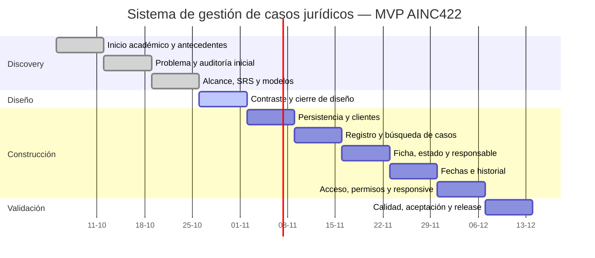

# Gantt actualizado del MVP

## Línea base temporal y capacidad

- Inicio oficial del curso: 5 de octubre de 2026.
- Primera clase efectiva: 10 de octubre de 2026, dentro de W1.
- Proyecto individual: una persona responsable de análisis, diseño, desarrollo y pruebas.
- Capacidad base: 12 horas semanales durante 10 semanas, total estimado de 120 horas.
- Las horas son planificación prospectiva. Las horas reales se registran al cierre
  de cada semana y no se reconstruyen retroactivamente sin evidencia.
- Una desviación semanal absoluta superior a 20 % respecto de 12 horas —menos de
  9,6 h o más de 14,4 h— obliga a analizar la causa y replanificar el trabajo pendiente.
- No se compensa una desviación incorporando funciones diferidas ni declarando
  como terminado un resultado que no cumple su Definition of Done.

## Cronograma rebaselinado

| Semana | Fechas | Trabajo estimado | Horas planificadas | Dependencia | Hito | Estado al 2026-10-27 |
|---|---|---|---:|---|---|---|
| W1 | 5–11 oct. | Inicio académico, contextualización y revisión de antecedentes | 12 | Ninguna | Inicio del curso y discovery | Periodo transcurrido; primera clase realizada el 10 oct.; horas reales pendientes de consolidar |
| W2 | 12–18 oct. | Revisar problema, evidencia y código v0.2.0 | 12 | W1 | Línea base técnica inicial | Periodo transcurrido; existen artefactos integrados, sin inferir horas ejecutadas |
| W3 | 19–25 oct. | Rebaselinar objetivos, SRS, historias, modelos y planificación | 12 | W2 | `v0.3` documental | Periodo transcurrido; documentación integrada en `develop`, horas reales pendientes de consolidar |
| W4 | 26 oct.–1 nov. | Cerrar contraste del prototipo, navegación, responsividad prevista y planificación | 12 | W3 | Puerta de definición y diseño `v0.4` | En curso; cierre sujeto a evidencia y criterios abiertos |
| W5 | 2–8 nov. | Conectar persistencia y completar flujo de clientes | 12 | W4 | Inicio de construcción; incremento clientes | Planificado |
| W6 | 9–15 nov. | Completar registro, edición, búsqueda y filtrado de casos | 12 | W5 | Incremento casos I | Planificado |
| W7 | 16–22 nov. | Construir ficha, estado, etapa, responsable e historial asociado | 12 | W6 | Incremento casos II | Planificado |
| W8 | 23–29 nov. | Construir fechas relevantes e historial básico verificable | 12 | W7 | Seguimiento básico | Planificado |
| W9 | 30 nov.–6 dic. | Implementar acceso, permisos y adaptación responsive; ejecutar calidad continua | 12 | W5–W8 | `v0.5` funcional | Planificado |
| W10 | 7–13 dic. | Completar Gherkin, accesibilidad, correcciones críticas, aceptación y release | 12 | W9 | Puerta de calidad y `v1.0` académico | Planificado |

## Coherencia de la fecha final

Se conserva W10 = 7–13 de diciembre y el total estimado de 120 horas. Esto es
coherente solo si lint, tipos, pruebas, Gherkin y trazabilidad se actualizan en
cada incremento de W5 a W9. W10 es una puerta final, no una semana destinada a
recuperar construcción atrasada. Si W4 no cierra definición y diseño, o si una
desviación supera el umbral, se debe replanificar antes de iniciar o ampliar trabajo.

## Dependencias críticas

`Línea base → diseño validado → persistencia → clientes → casos → seguimiento →
acceso y permisos → aceptación`.

El acceso se implementa al final del incremento funcional por decisión expresa,
pero ningún entorno puede declararse apto para datos reales sin `RNF-005`.

## Cierre y control semanal

Cada cierre semanal debe registrar en un issue de seguimiento:

1. horas planificadas, horas reales y desviación porcentual;
2. elementos comprometidos, terminados según DoD y trasladados;
3. riesgos, bloqueos y decisión de replanificación cuando corresponda;
4. enlaces a Issues, PR integrados y ejecución de CI;
5. RF/RNF/HU actualizados en la trazabilidad;
6. confirmación de que no ingresaron funciones diferidas sin control de cambios.

La fórmula es `desviación = (horas reales - 12) / 12 × 100`. El estado semanal
se basa en evidencia integrada, no en porcentajes subjetivos de avance.
